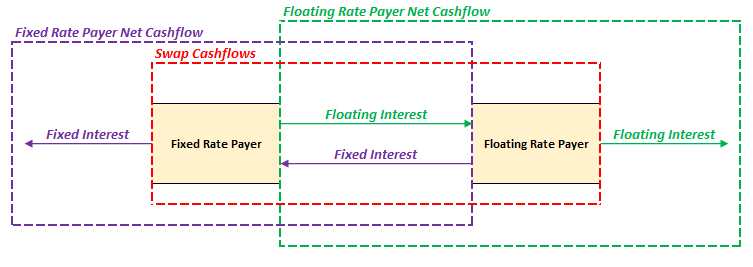

# **Swaps**

A **Swap Contract** is an agreement between two parties to **exchange cashflows** (*swap*) at specified future time point(s), traded only in **OTC markets**. This exam will mainly focus on **Interest Rate Swaps**, where two parties exchange interest payments (fixed & floating) on the same notional amount:

* **Fixed Interest Rate** - Constant interest throughout the duration of the loan
* **Floating Interest Rate** - Variable interest rate; typically expressed in the form of a **reference value with a spread**

| **Fixed Rate Payer**             | **Floating Rate Payer**        |
| :------------------------------- | :----------------------------- |
| Loan at Fixed Rate               | Loan with Floating Rate        |
| Pays counterparty Floating Rate  | Pays counterparty Fixed Rate   |
| Receives Fixed Rate              | Receives Floating Rate         |
| Net pays Floating Rate (swapped) | Net pays Fixed Rate (swapped)  |
| Believes that rates will go down | Believes that rates will go up |

The outcome is that fixed rates become floating rates, vice versa. This can be used to transform both assets and liabilities that depend on fixed or floating rates to the other type.

!!! Tip

    Interest rates are typically measured in a special unit known as **Basis Points** (bps):

    $$
        \text{1 bps} = 0.01% \\
        \therefore \text{100 bps} = 1.00%
    $$

    Basis point is basically a smaller unit of measure than percentage point (EG. mm vs cm). Apart from being a shorthand, the key reason is for **clarity**:

    * Expressing changes in percentages could either refer to additive or multiplicative increases; EG. 10% increased by 10% could either refer to 11% (multiplicative) or 20% (additive)
    * 10% increased by 1000 bps strictly refers to **additive increases** (20%)

There are other kinds of Swaps that were briefly mentioned in the source material:

* Currency Swaps
* Equity Swaps
* Commodity Swaps
* Credit Default Swaps
* Volatility Swaps

## **Payoff, Profit & Value**

The payoff for a swap contract should ONLY consider cashflows that **took place because of the swap**; the exchange of cashflows. Similarly, since there is **no cost** to enter the contract, the payoff and profit of a swap is the **same**.

$$
    \text{Profit}_{\text{Fixed}}
    = \text{Payoff}_{\text{Fixed}}
    = \text{Notional Amount} \cdot \left(i_{\text{Floating}} - i_{\text{Fixed}} \right)
$$

<!-- Self Made -->
{.center}

!!! Tip

    The payoff for the fixed and floating payer are equal and opppsite; just like long and short positions:
    
    $$
         \text{Payoff}_{\text{Fixed}}
         = \text{Payoff}_{\text{Floating}}
    $$

!!! Warning

    Any computation should be based on the **EFFECTIVE interest rate** ($i$) per payment period. However,  unless otherwise stated, the rates provided in the question are usually the **ANNUAL NOMINAL interest rates**. Thus, there is a need to convert them:

    $$
    \begin{aligned}
        i &= r \cdot \frac{1}{n} \\
        \text{Effective} &= \text{Nominal} \cdot \text{Compounding Frequency}
    \end{aligned}
    $$

Similar to forwards and futures, the **value of the swap at time 0 is 0**; the net present value of all future cashflows are 0.

!!! Tip
 
    If the present value at the current rates is not 0, then the **fixed rate** of the swap will be **adjusted till it becomes 0**.
    
    In such a scenario, the fixed rate payer’s spread on the reference rate will be different from the floating rate payer’s based on the adjustment amount.

!!! Note

    It is useful to think about a swap as a **series of forward contracts**.

For the purposes of this exam, there are two common floating interest rate patterns. Consider the **perspective of the fixed rate payer**:

| ***Increasing Floating** | **Decreasing Floating** |
| :-: | :-: |
| Initially lower than fixed | Initially higher than fixed |
| Initial positive payments | Initial negative payments |
| Value decreases over time | Value increases over time |

!!! Tip

    Value is determined prospectively. Since the payments can be assumed to have an increasing or decreasing pattern, moving forward in time leaves more negative/ positive payments remaining, causing the value to decrease/increase.

## **Comparative Advantage**

**Comparative Advantage** is a concept in international economics which states that **EVEN IF one party can produce all kinds of goods more efficiently than others**, they should still produce the good that they **relatively more efficient** at compared to others and trade for the other types of goods. This will result in a **better outcome for all parties than if they had individually produced** all types of goods. In the context of interest rate swaps:

* Parties should borrow at the fixed/floating that they have a **comparative advantage in** (Assumed not to be their desired type of loan)
* Enter into an **interest rate swap to transform it** into a floating/fixed rate

| **Party**   | **Fixed Rate** | **Floating Rate** |
| :---------- | :------------: | :---------------: |
| **Party A** |       W        |   Reference + Y   |
| **Party B** |       X        |   Reference + Z   |

1. Determine the **difference in borrowing costs** for both fixed and floating rates
2. Use the rate that has the **larger difference** to determine the comparative advantages
3. The party that has a **lower rate in (2)** has a comparative advantage in that type of rate

!!! Warning

    Since interest rates represent COSTS, the **lower the rate, the better**.

!!! Note
  
    The differences in borrowing rates for both companies typically arise from **different credit ratings**. 

It can be shown that the **total borrowing costs** (diagonal sum) for both parties is **lower as a result of the swap**:

$$
    W + \text{Reference} + Z <> X + \text{Reference} + Y
$$

It can be shown that the cost savings is equally split between both parties:

$$
    \text{Swapped Rate} = \text{Non-Swapped Rate} + \frac{\text{Cost Saving}}{2}
$$

## **Floating Rate References**

LIBOR
SOFR

There are two commonly used reference rates in the US. LIBOR was phased out in

| **LIBOR**                                        | **SOFR**                                        |
| :----------------------------------------------- | :---------------------------------------------- |
| London Interbank Offered Rate                    | Secured Overnight Financing Rate                |
| Rate for short term **unsecured** funds          | Rate for short term funds **backed by T-bills** |
| Some default risk                                | Risk free                                       |
| **Estimated** via surveys; prone to manipulation | Based on **actual** transactions                |
| Known at **beginning** of period                 | Known only at **end of period**                 |

Deriving interest rates